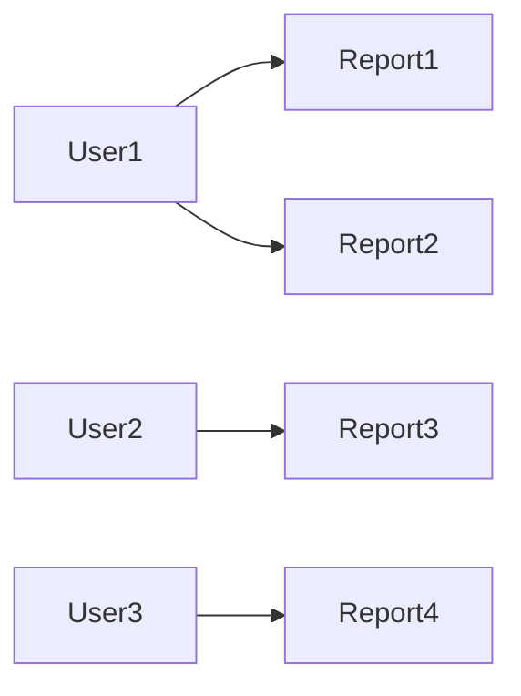

# Database Design

## Report Entity

A report describes one lost or found item. Each report stores the contact method chosen by the reporter.

| Field          | Data Type          | Required | Description                                                           |
| :------------- | :----------------- | :------- | :-------------------------------------------------------------------- |
| `id`           | String, UUID       | Yes      | Primary key                                                           |
| `title`        | String             | Yes      | Name of the lost or found item                                        |
| `description`  | String, Text       | Yes      | Item description and chronology                                       |
| `type`         | Enum `ReportType`  | Yes      | `LOST` or `FOUND`                                                     |
| `category`     | Enum `Category`    | Yes      | Item category                                                         |
| `location`     | String             | Yes      | Campus location, for example `Gedung A` or `Student Lounge (Floor 1)` |
| `date`         | DateTime           | Yes      | Date when the item was lost or found                                  |
| `imageUrl`     | String, nullable   | No       | Cloudinary image URL, `null` when the report has no photo             |
| `reporterName` | String             | Yes      | Private reporter name, omitted from public read responses             |
| `contactType`  | Enum `ContactType` | Yes      | Contact method chosen by the reporter                                 |
| `contactValue` | String             | Yes      | Phone number, account username, or email address                      |
| `createdAt`    | DateTime           | Yes      | Timestamp when the report was posted                                  |
| `updatedAt`    | DateTime           | Yes      | Timestamp of the last edit                                            |

## Enumerations

| Enum          | Values                                                              |
| :------------ | :------------------------------------------------------------------ |
| `ReportType`  | `LOST`, `FOUND`                                                     |
| `Category`    | `ELECTRONICS`, `TUMBLER`, `ID_CARD`, `ACCESSORIES`, `MISCELLANEOUS` |
| `ContactType` | `WHATSAPP`, `LINE`, `INSTAGRAM`, `DISCORD`, `EMAIL`                 |

## Relationships

- **Report:** Stands alone in the MVP. The row stores `reporterName` privately, so an account record is not required
- **User to Report:** SSO UI sign-in adds a `User` model, and one user can create a set of reports. The `authorId` field identifies the report owner for edit and delete checks

## Schema and API Mapping

The `contact` object in the API response maps to two columns in the database.

| API field       | Prisma field   | Notes      |
| :-------------- | :------------- | :--------- |
| `contact.type`  | `contactType`  | Enum value |
| `contact.value` | `contactValue` | String     |

The remaining response fields use the same names as their database columns.

The schema is in [`backend/prisma/schema.prisma`](../backend/prisma/schema.prisma), and migrations are in [`backend/prisma/migrations`](../backend/prisma/migrations).
